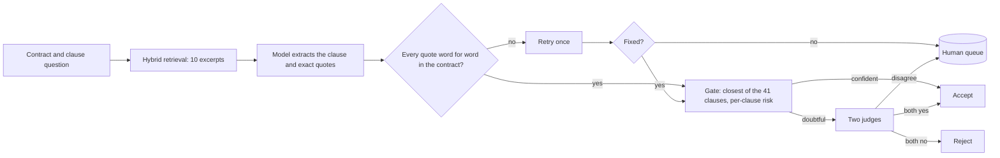

# CUAD Contract Intelligence

[](https://github.com/S-Ananth7/cuad-contract-intelligence/actions/workflows/ci.yml)


**Finds 41 types of clauses in commercial contracts, quotes the exact sentence, proves the quote exists word for word, and sends only the doubtful cases to a person.**

Built and scored on the lawyer-annotated [CUAD v1](https://www.atticusprojectai.org/cuad) dataset (510 contracts). It targets three problems of using a language model on contracts:

| Problem | How it is handled |
|---|---|
| **Cost** | Retrieves 10 relevant excerpts per question instead of sending the whole contract: about 81% fewer input tokens |
| **Invented quotes** | Every quote is checked against the contract by plain code, retried once, then queued: 3 invented quotes in the test run, none accepted |
| **Knowing what to trust** | A gate and two judges decide accept, reject or queue, so a person reads about 1.8 answers per contract, not all of them |

## Results

Scored once on the 102 official test contracts (4,182 questions), after the design was frozen.

| Stage | Precision | Recall |
|---|---|---|
| Retrieval and model only | 0.603 | 0.949 |
| Plus one review judge | 0.726 | 0.922 |
| **Full pipeline, no human involved** | **0.757** | **0.916** |
| Same, and the quote must also overlap the lawyers' highlighted passage | 0.703 | 0.850 |
| With a perfect human on the queue (upper bound, not measured) | 0.762 | 0.943 |

- **Decisions:** 1,505 accepted (1,139 real clauses), 273 rejected (12 real), 184 queued for a person (34 real).
- **Cost:** about 2,430 input tokens per question, against about 12,770 for the whole contract (the baseline comes from 9 contracts, so treat 81% as approximate).
- **Margin:** about plus or minus 0.02 on precision.
- **Scoring:** the headline counts an answer as right when the lawyers marked that clause in the contract; the stricter row also needs the quote to overlap their passage. Definitions and limits: [`docs/evaluation-protocol.md`](docs/evaluation-protocol.md). Every decision is committed in [`evals/final_test/`](evals/final_test/README.md) and recomputed by tests.

## How it works



1. **Retrieval.** Postgres with pgvector: similarity to lawyers' examples plus learned keywords, merged by reciprocal rank fusion.
2. **Extraction.** One model call per clause returns a found flag, the value and exact quotes. The reply is parsed and validated, never trusted.
3. **Quote check.** A quote must appear in the contract word for word. A failure is retried once, then queued.
4. **Gate.** The quote is compared with lawyers' examples of all 41 clauses; a confident, low-risk answer is accepted.
5. **Two judges.** Doubtful answers go to two prompts. Both yes accepts, both no rejects, a split is queued.

The reasoning behind each choice is in the [decision records](docs/adr/README.md).

## Quick start

Requires Python 3.10 or newer and Docker.

```powershell
# 1. Install
python -m venv venv
.\venv\Scripts\Activate.ps1          # Linux/macOS: source venv/bin/activate
pip install -e ".[dev,api]"

# 2. Configure: copy the template, then fill in LLM_API_KEY, LLM_BASE_URL, LLM_MODEL, DATABASE_URL, POSTGRES_PASSWORD
Copy-Item .env.example .env          # Linux/macOS: cp .env.example .env

# 3. Start Postgres 17 with pgvector (applies the schema on first start; port 5433 unless DB_PORT is set)
docker compose up -d db

# 4. Load and embed CUAD once (the embedding steps take a while)
python scripts/load_contracts.py
python scripts/load_clauses.py
python scripts/load_highlights.py
python scripts/load_chunks.py
python scripts/embed_chunks.py
python scripts/set_splits.py
python scripts/embed_highlights.py

# 5. Run the pipeline on a few validation contracts (calls the model, costs a little)
$env:SET="validation"; $env:LIMIT="5"; $env:K="10"
python -m cuad_ai pipeline
```

The data is not in this repository: download CUAD v1 and put `CUADv1.json` and `test.json` in `data/`. Never commit `.env`.

## Usage

`python -m cuad_ai --help` lists the commands. `pipeline` runs every stage and prints the score table; each stage also runs alone.

| Command | What it does |
|---|---|
| `pipeline [run folder]` | All stages in order (extracts first when no folder is given) |
| `extract` | Retrieve excerpts, ask the model, verify and retry the quotes |
| `gate`, `route` | Compare quotes with the lawyers' examples; split into accept and review with the frozen risk table |
| `judge1`, `judge2` | The two judges (the second also sees lawyer examples) |
| `finalize` | Accept, reject or queue every question; writes `final.json` and `queue.json` |
| `freeze-risk` | Write `evals/risk_table.json` from validation runs |
| `serve` | Start the read-only API |

Runs land in `evals/runs/<run folder>/`. Identical model calls are cached in `evals/cache/` (set `NO_CACHE=1` to bypass).

**Run history and API.** `python scripts/load_run.py [run folder]` stores a run in Postgres, where the `run_scores` view recomputes precision and recall. `python -m cuad_ai serve` then exposes stored runs at `http://127.0.0.1:8000/docs`:

| Endpoint | Returns |
|---|---|
| `GET /health`, `GET /ready` | The process is up; the database answers |
| `GET /runs`, `GET /runs/{id}` | Stored runs with their scores and monitoring numbers |
| `GET /runs/{id}/queue` | The answers waiting for a person, with quotes and reasons |
| `GET /metrics` | Monitoring numbers of the latest run as Prometheus text |

Monitoring numbers need no lawyer labels: share accepted, rejected and queued, queue per contract, retry rate, invented-quote rate, and tokens and seconds per question.

## Keeping the result honest

Official train and test split. The example bank excludes every company that appears in the test set. Learned keywords and the per-clause risk table never use the contracts being scored (`evals/risk_table.json` is frozen). The test run needs `CONFIRM_TEST=yes` and was run once: do not re-run it to tune. Details: [`docs/evaluation-protocol.md`](docs/evaluation-protocol.md).

## Documentation

| Read | For |
|---|---|
| [`docs/architecture.md`](docs/architecture.md) | Components, data model, data flow, operations |
| [`docs/evaluation-protocol.md`](docs/evaluation-protocol.md) | Splits, leakage rules, metric definitions, what is and is not measured |
| [`docs/adr/`](docs/adr/README.md) | Seven decision records: what was chosen, why, and what it costs |
| [`notes/final_test_result.md`](notes/final_test_result.md) | The final result, controls and frozen settings |
| [`notes/`](notes/) | Design history: production design, routing, retrieval, earlier decisions |

## Development

```powershell
make check          # lint and tests, what CI runs (or: ruff check . ; python -m pytest -q)
pre-commit install  # optional: lint and secret check before each commit
```

Database tests skip when no database is reachable, so the suite runs on a fresh clone. CI runs lint and the full suite against a pgvector service on every push, on Python 3.10 and 3.12.

```
src/cuad_ai/   package: ingestion, search, extraction, validation, metrics, run storage, monitoring, API;
               pipeline/ holds the stages, cli.py the single command
scripts/       data loaders, embedding jobs, run loader, analysis helpers
evals/         frozen risk table, split files, committed final-test evidence; run output is git-ignored
prompts/       extraction and judge prompts          sql/ docker/   schema, run tables, database init
tests/         unit tests with fake data; database tests roll back
docs/ notes/   current documentation; design history
```

## Limitations

- **Judges share a model,** so they can make the same mistake; the queue only catches disagreement.
- **Retrieval caps recall:** about 7% of lawyer-marked passages are not in the top 10 excerpts.
- **Labels are incomplete,** so some "false alarms" may be real clauses nobody marked.
- **Long quotes can be cut** by the 800-token output limit (7 of 4,182 here, all queued).
- **US commercial contracts only.** Other jurisdictions, languages and contract types are untested.
- **Hosted model:** prompts go to the provider. CUAD is public; do not send confidential contracts to a provider you have not vetted.

## Roadmap

Next: error analysis on the accepted-but-wrong answers, a different model for the second judge, comparing runs over time, and live extraction through a job queue.

## License and citation

MIT, see [`LICENSE`](LICENSE). CUAD v1 is licensed CC BY 4.0. Hendrycks, Burns, Chen and Ball. *CUAD: An Expert-Annotated NLP Dataset for Legal Contract Review.* NeurIPS 2021.
