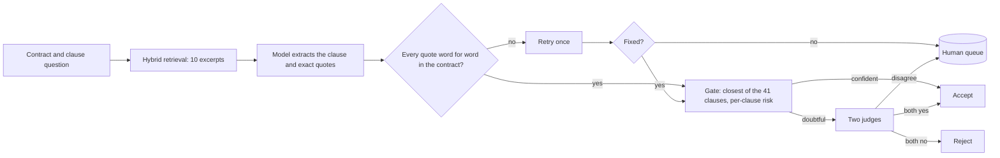

# CUAD Contract Intelligence

Finds 41 types of clauses in commercial contracts, quotes the exact sentence, proves the quote exists word for word, and sends only the doubtful cases to a person. Built and scored on the lawyer-annotated [CUAD v1](https://www.atticusprojectai.org/cuad) dataset (510 contracts).

## Result

Scored once on the 102 official test contracts (4,182 questions), after the design was frozen. Details and the controls that keep it honest: [`notes/final_test_result.md`](notes/final_test_result.md). The decision behind every number is committed in [`evals/final_test/`](evals/final_test/) and recomputed by a test.

| Stage | Precision | Recall |
|---|---|---|
| Retrieval and model only | 0.603 | 0.949 |
| Plus one review judge | 0.726 | 0.922 |
| **Full pipeline, no human involved** | **0.757** | **0.916** |
| If a person resolved the queue perfectly (upper bound, not measured) | 0.762 | 0.943 |

- The headline is scored at clause level. Precision is the share of accepted answers where the lawyers marked that clause in the contract. Recall is the share of lawyer-marked clauses that were accepted. A stricter check also requires the model's quote to overlap the passage the lawyers highlighted: precision 0.703, recall 0.850 (1,058 of 1,505 accepted answers; recomputed by a test from the committed decisions). Of the 81 answers that lose, 34 are Document Name and date clauses.
- Of 4,182 questions, 1,505 were accepted automatically, 273 rejected, and 184 queued for a person (about 1.8 per contract). Only 12 of the 273 rejected answers were real clauses.
- Precision has a margin of error of about 0.02. Invented quotes in the whole test run: 3.
- Cost: about 2,430 input tokens per question, against about 12,770 when the whole contract is sent (roughly 81% less; the whole-contract figure comes from 9 contracts).
- Weakest clauses: Price Restrictions, Third Party Beneficiary, Post-Termination Services, Uncapped Liability, Volume Restriction.

## How it works



1. **Retrieval.** Postgres with pgvector. Keyword search, a search by similarity to lawyers' examples, and reciprocal rank fusion pick 10 excerpts. Header clauses (title, parties, dates) also get the first chunks of the contract.
2. **Extraction.** One model call per clause returns a found flag, the value, and exact quotes. The reply is parsed and validated, never trusted.
3. **Deterministic quote check.** A quote must appear in the contract word for word (spacing and line breaks ignored). A found answer without a verified quote is retried once, then queued.
4. **Gate.** The quote is compared with the lawyers' examples of all 41 clauses. If the asked clause is the closest and its historical false-alarm rate is low, the answer is accepted.
5. **Two judges.** Doubtful answers are reviewed by two independent prompts. Both yes accepts, both no rejects, a split goes to the queue.
6. **Queue.** `queue.json` lists what a person should look at and why.

**Leakage controls.** Official train and test split; the example bank excludes any company that appears in the test set; learned keywords and the per-clause risk table use training and validation contracts only (`evals/risk_table.json` is frozen); the test run is behind `CONFIRM_TEST=yes` and was run once. Do not re-run it to tune: that would invalidate the result.

## Quick start

Requires Python 3.10 or newer and Docker (for Postgres with pgvector).

```
python -m venv venv
.\venv\Scripts\Activate.ps1        # Linux/macOS: source venv/bin/activate
pip install -e ".[dev,api]"
Copy-Item .env.example .env        # Linux/macOS: cp .env.example .env
```

1. **Settings.** Fill in `.env`: `LLM_API_KEY`, `LLM_BASE_URL`, `LLM_MODEL`, `DATABASE_URL`, `POSTGRES_PASSWORD`. Never commit `.env`.
2. **Data.** Download the CUAD v1 release and put `CUADv1.json` and `test.json` in `data/`. The data is not in this repo.
3. **Database.** `docker compose up -d db` starts Postgres 17 with pgvector and applies `sql/schema.sql` on first start. Compose uses port 5433 by default (`DB_PORT` changes it).
4. **Load and embed** (once; the embedding steps take a while):

```
python scripts/load_contracts.py
python scripts/load_clauses.py
python scripts/load_highlights.py
python scripts/load_chunks.py
python scripts/embed_chunks.py
python scripts/set_splits.py
python scripts/embed_highlights.py
```

5. **Run the pipeline** on a few validation contracts (this calls the model and costs a little):

```
$env:SET="validation"; $env:LIMIT="5"; $env:K="10"
python -m cuad_ai pipeline
```

`pipeline` runs extraction, the gate, both judges and the final decision, and prints the score table. Results land in `evals/runs/<run folder>/`. Identical model calls are cached in `evals/cache/`; set `NO_CACHE=1` to bypass it.

Every stage also runs alone, and `python -m cuad_ai --help` lists them:

| Command | Stage |
|---|---|
| `extract` | Retrieve excerpts, ask the model, verify and retry the quotes |
| `gate` | Compare each quote with the lawyers' examples of all 41 clauses |
| `route` | Split answers into accept and review using the frozen risk table |
| `judge1`, `judge2` | The two judges (the second also sees lawyer examples) |
| `finalize` | Accept, reject or queue every question and print the scores |
| `freeze-risk` | Write `evals/risk_table.json` from validation runs |

6. **Keep the run in Postgres** (optional). `python scripts/load_run.py evals/runs/<run folder>` stores the run so runs can be compared with SQL; with no argument it loads the committed final test run. The `run_scores` view recomputes accepted, rejected, queued, precision and recall from the stored answers.

## API and monitoring

A small read-only API serves stored runs. It does not run extraction: that is a long, costly job and belongs in a queue, not in a web request.

```
python scripts/load_run.py                 # store the committed final run (or pass a run folder)
python -m cuad_ai serve                    # http://127.0.0.1:8000/docs, or: serve <host> <port>
```

| Endpoint | Returns |
|---|---|
| `GET /health`, `GET /ready` | The process is up; the database answers (503 when it does not) |
| `GET /runs` | Every stored run with accepted, rejected, queued, precision and recall |
| `GET /runs/{id}` | The scores and the monitoring numbers below |
| `GET /runs/{id}/queue?limit=&offset=` | The answers waiting for a person: quotes, reason, what the judges thought it looked like |
| `GET /metrics` | The monitoring numbers of the latest run as Prometheus text |

Monitoring numbers need no lawyer labels, because in use you cannot compute precision. They are the signals you can always see: the share of questions accepted, rejected and queued, queued answers per contract, the retry rate, the invented-quote rate, the queue reasons, and extraction tokens and seconds per question. A sudden change in one of them means the model, the prompt or the documents changed. On the final test run: 4.4% of questions queued (1.8 per contract), 0.6% retried, 0.07% invented quotes.

## Development

| Task | Command |
|---|---|
| Install with dev tools | `pip install -e ".[dev,api]"` |
| Lint | `ruff check .` |
| Tests | `python -m pytest -q` |
| Both (what CI runs) | `make check` |

Database tests skip when no database is reachable, so the suite runs on a fresh clone. CI (`.github/workflows/ci.yml`) runs lint and the full suite against a pgvector service on every push. Optional: `pre-commit install` for a lint and secret check before each commit.

## Repository layout

```
src/cuad_ai/   package: data loading, ingestion, embeddings, search, extraction, validation, metrics, settings,
               run storage, monitoring numbers, the read-only API; pipeline/ holds the stages and
               cli.py the single command (python -m cuad_ai)
scripts/       data loaders, embedding jobs, run loader, analysis helpers
evals/         baseline and earlier experiment runners, frozen risk table, split files, run log (results.md);
               run output is git-ignored
prompts/       extraction and judge prompts
sql/           database schema (schema.sql) and run history tables (runs.sql)
docker/        database initialisation
tests/         unit tests with fake data; database tests roll back
notes/         design decisions, evaluation protocol, final test result
```

## Documentation

| Read | For |
|---|---|
| [`docs/architecture.md`](docs/architecture.md) | How the system is built: components, data model, data flow, operations |
| [`docs/evaluation-protocol.md`](docs/evaluation-protocol.md) | Splits, leakage rules, metric definitions, what is measured and what is not |
| [`docs/adr/`](docs/adr/README.md) | Seven decision records: what was chosen, why, and what it costs |
| [`notes/final_test_result.md`](notes/final_test_result.md) | The result, the controls, the frozen settings |
| [`notes/production_design.md`](notes/production_design.md) | The production design and decision policy |
| [`notes/routing_and_review.md`](notes/routing_and_review.md) | Gate, risk table, two judges, queue |
| [`notes/ingestion_and_retrieval.md`](notes/ingestion_and_retrieval.md) | Database, split rules, retrieval |
| [`notes/decisions.md`](notes/decisions.md) | Earlier decisions and the reasoning behind them |

## Limitations

- **Truncated quotes.** An 800-token output cap cuts very long quotes, which show up as parse failures or unverified quotes (7 of 4,182 here, all queued).
- **Correlated judges.** Both judges use the same model, so they can make the same mistake. The queue only catches disagreement.
- **Incomplete labels.** CUAD labels are not exhaustive; some "false alarms" may be real clauses the lawyers did not mark, so true precision may be higher.
- **Narrow data.** US commercial contracts only. Other jurisdictions, languages and contract types are untested.
- **Margins.** Per-clause scores for rare clauses rest on few examples and are noisy.
- **Hosted model.** Prompts go to the model provider. CUAD is public, so that is fine here; do not send confidential contracts to a provider you have not vetted.

## Roadmap

Done: evaluation, retrieval, extraction, quote verification, routing, judges, retry, human queue, tests, one place for settings, CI, Docker, run history in Postgres, pipeline in the package behind one command, a thin read-only API and label-free monitoring. Next: architecture notes and decision records, comparing runs over time, error analysis on the accepted-but-wrong answers, and live extraction through a job queue.

## License and citation

MIT, see `LICENSE`. CUAD v1 is licensed CC BY 4.0. Hendrycks, Burns, Chen and Ball. *CUAD: An Expert-Annotated NLP Dataset for Legal Contract Review.* NeurIPS 2021.
