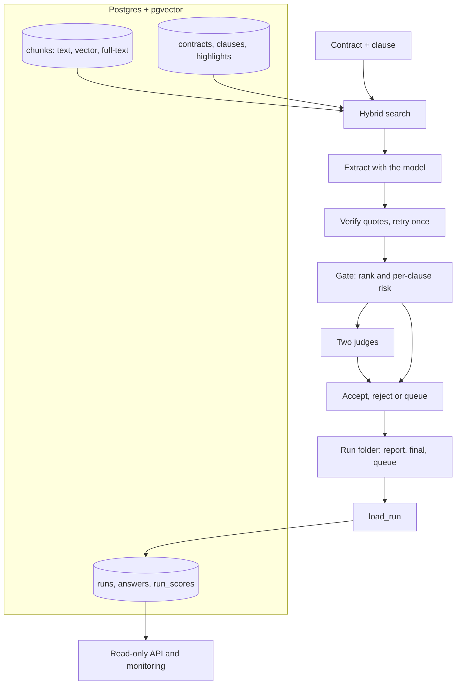

# Architecture

How the system is built and where each part lives. For the reasoning behind each choice see the [decision records](adr/README.md); for how the numbers were produced see the [evaluation protocol](evaluation-protocol.md).

## Purpose and scope

Find 41 types of clauses in commercial contracts, quote the exact text, prove the quote exists in the contract, and send only doubtful answers to a person. Built and scored on CUAD v1 (510 contracts, 41 clauses).

In scope: retrieval, extraction, quote verification, routing, review by two judges, a human queue, run history, a read-only API and monitoring. Out of scope: legal advice, contracts outside CUAD, authentication and a user interface, live extraction through a web request, and fine-tuning a model.

## System overview

## Components

| Part | Where | What it does |
|---|---|---|
| Settings | `src/cuad_ai/settings.py` | The single place for thresholds, model name, retrieval constants and environment knobs |
| Ingestion | `src/cuad_ai/ingest.py`, `loader.py`, `scripts/load_*.py` | Contracts, clauses, lawyer highlights and chunks into Postgres |
| Embeddings | `src/cuad_ai/embed.py`, `embed_highlights.py` | Local `bge-small-en-v1.5` vectors (384 numbers) for chunks and for the example bank |
| Search | `src/cuad_ai/search.py`, `terms.py` | Header rule, similarity to lawyer examples, learned keywords, reciprocal rank fusion |
| Extraction | `src/cuad_ai/extract.py`, `clauses.py`, `context.py`, `llm.py`, `cache.py` | Prompt, model call (cached), parse and validate the reply |
| Quote check | `src/cuad_ai/validate.py` | Deterministic test that a quote appears in the contract |
| Pipeline | `src/cuad_ai/pipeline/` | Stages in order: `extraction`, `gate`, `route`, `judge_quote`, `judge_examples`, `finalize`, plus `risk` and `run_all` |
| Command line | `src/cuad_ai/cli.py` | `python -m cuad_ai <stage>`, `pipeline` for all stages, `serve` for the API |
| Metrics | `src/cuad_ai/metrics.py` | Counts, precision, recall, invented quotes, tokens, seconds |
| Run history | `sql/runs.sql`, `src/cuad_ai/runstore.py` | Runs and answers in Postgres; the `run_scores` view recomputes the headline numbers |
| Monitoring and API | `src/cuad_ai/monitor.py`, `api.py` | Label-free numbers and a read-only API over stored runs |

## Data model

| Table | Content |
|---|---|
| `contracts` | 510 rows: title, company, length, `official_split`, `shares_company_with_test` |
| `clauses` | 41 rows: name and the CUAD question |
| `highlights` | 13,823 lawyer-marked passages; the 10,848 in the example bank also have an embedding |
| `chunks` | 33,809 contract pieces of about 1,000 characters (200 overlap), with a vector and a full-text column |
| `runs` | One row per stored run: model, prompt hash, code commit, settings and summary |
| `answers` | One row per question: decision, reason, the lawyers' label, retry flag, quotes for queued answers |
| `run_scores` (view) | Accepted, rejected, queued, precision and recall computed from `answers` |

Run history stores titles and clause names as text, not ids, so a stored run stays readable if the contract tables are reloaded.

## Data flow of one run

Each stage reads files from the run folder and writes the next, so any stage can be re-run alone.

| Stage | Reads | Writes | Model calls |
|---|---|---|---|
| `extract` | the database, prompt | `report.json` | one per question, one more on a retry |
| `gate` | `report.json` | `gate_features.json` | none |
| `route` | `gate_features.json`, `evals/risk_table.json` | `routing.json` | none |
| `judge1` | `routing.json`, `report.json` | `verified.json` | one per doubtful answer |
| `judge2` | `verified.json`, `report.json` | `verified_examples.json` | one per doubtful answer |
| `finalize` | `report.json`, `verified_examples.json` | `final.json`, `queue.json` | none |

Final decision per question: not found, accept, reject, or queue (reasons: judges disagree, reply could not be parsed after a retry, quote not found word for word after a retry).

## Design principles

- **The model never has the last word.** Everything it returns is parsed, validated, and checked against the contract. A quote that is not in the contract is never accepted.
- **Deterministic checks wrap the non-deterministic part.** Quote verification, routing and the final decision are plain code with unit tests.
- **Anything learned from data is kept away from the data being scored.** Keywords, the example bank and the risk table exclude the contracts they are applied to.
- **One place for settings, one command to run, evidence committed.** The final test result is in `evals/final_test/` and recomputed by tests.

## Operations

| Task | How |
|---|---|
| Start the database | `docker compose up -d db` |
| Run the pipeline | `python -m cuad_ai pipeline` (settings `SET`, `K`, `LIMIT`, `OFFSET` from the environment) |
| Store a run | `python scripts/load_run.py [run folder]` |
| Serve stored runs | `python -m cuad_ai serve` then open `/docs` |
| Check everything | `make check` (lint and tests; CI runs the same against a pgvector service) |

Monitoring numbers that need no labels: queue rate and queue per contract, retry rate, invented-quote rate, queue reasons, extraction tokens and seconds per question.

## Known limits

- Both judges use the same model, so they can share a mistake. See [ADR 0005](adr/0005-two-judges-must-agree.md).
- The API reads stored runs only. Running extraction on request would need a job queue.
- Judge tokens are not stored with a run, only extraction tokens and time.
- CUAD only: US commercial contracts. Other jurisdictions, languages and contract types are untested.
